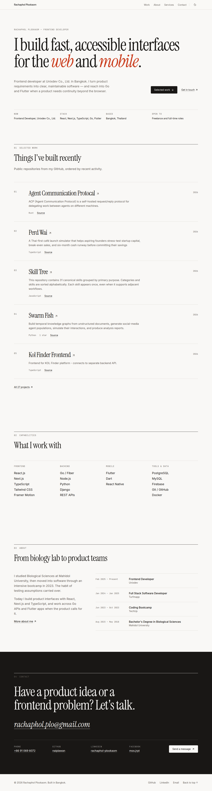

# Rachaphol Plookaom — Portfolio

Personal portfolio of a frontend developer in Bangkok, built with Next.js 16, React 19, TypeScript, and Tailwind CSS 3.4.

Live: https://rachaphol-portfolio.vercel.app



## Features

- **Minimal editorial design** — serif display type, hairline rules, one vermilion accent, light and dark themes
- **Projects from GitHub** — public, non-fork repositories fetched at build time (revalidated hourly) with a curated fallback
- **Contact form** — EmailJS delivery with validation, a honeypot field, and client-side rate limiting
- **Pages** — home, projects, about, services, booking, contact, plus 404 and error pages
- **SEO** — metadata, JSON-LD structured data, generated sitemap, robots and manifest routes, and a generated Open Graph image
- **Accessibility** — skip link, semantic landmarks, focus-trapped mobile menu, `prefers-reduced-motion` support; content renders without JavaScript
- **Security headers** — CSP and related headers configured in `next.config.mjs`

## Getting started

```bash
git clone https://github.com/naiplawan/portfolio-react-page.git
cd portfolio-react-page
pnpm install
cp .env.example .env.local   # then fill in values
pnpm dev                     # http://localhost:3000
```

Requires Node.js 24 and pnpm 10.

### Environment variables

| Variable | Purpose |
| --- | --- |
| `NEXT_PUBLIC_APP_URL` | Canonical site URL used in metadata and structured data |
| `NEXT_PUBLIC_EMAILJS_SERVICE_ID`, `NEXT_PUBLIC_EMAILJS_TEMPLATE_ID`, `NEXT_PUBLIC_EMAILJS_PUBLIC_KEY` | Contact form delivery; the form shows an email fallback when unset |
| `NEXT_PUBLIC_GITHUB_USERNAME` | GitHub account to list projects from (defaults to `naiplawan`) |
| `GITHUB_TOKEN` | Optional; raises the GitHub API rate limit |
| `NEXT_PUBLIC_GA_MEASUREMENT_ID` | Optional Google Analytics ID |
| `GOOGLE_VERIFICATION_CODE` | Optional Search Console verification |

## Scripts

| Command | What it does |
| --- | --- |
| `pnpm dev` | Start the dev server |
| `pnpm build` / `pnpm start` | Production build and server |
| `pnpm lint` | ESLint |
| `pnpm tsc --noEmit` | Type check |
| `pnpm test` / `pnpm test:run` | Vitest (watch / single run) |

## Project structure

```
app/
  page.tsx               Home: hero, selected work, capabilities, about, contact
  projects/ about/ services/ booking/ contact/
  api/github/projects/   GitHub projects API route
  opengraph-image.tsx    Generated social preview image
  globals.css            Theme tokens (light/dark) and editorial utilities
components/
  sections/              Home page sections
  portfolio/             NavBar, Footer, About page parts
  ui/                    Button, Input, Textarea, SectionHeading, theme toggle
  seo/ analytics/ layout/ accessibility/
lib/
  data/                  Project fallback data and career timeline
  github-api.ts          GitHub API client
  utils/                 GitHub sync, rate limiter, class merging
audit-screenshots/       Current light/dark and mobile screenshots of every page
```

## Design system

Colors are HSL tokens in `app/globals.css` (`:root` and `.dark`) and are exposed to Tailwind through `tailwind.config.js`. Pages are built from a shared `SectionHeading` and ruled lists instead of cards. See [`CLAUDE.md`](CLAUDE.md) for the full conventions.

## Deployment

Deployed on Vercel. Set the environment variables above in the project settings, then push to the production branch or run `vercel --prod`.

## Author

**Rachaphol Plookaom** — [GitHub](https://github.com/naiplawan) · [LinkedIn](https://www.linkedin.com/in/rachaphol-plookaom)
