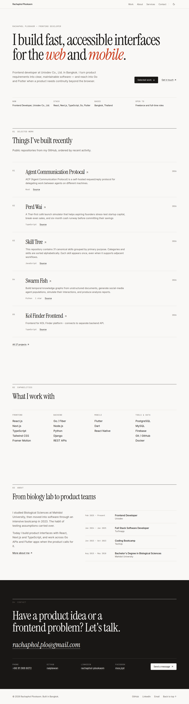

# Rachaphol Plookaom — Portfolio

Personal portfolio of a frontend developer in Bangkok, built with Next.js 16, React 19, TypeScript, and Tailwind CSS 3.4.

Live: https://rachaphol.vercel.app



## Features

- **Minimal editorial design** — serif display type, hairline rules, one vermilion accent, light and dark themes
- **Selected case studies** — three handpicked projects with screenshots, contributions, design decisions and qualitative outcomes; the home page renders independently of GitHub
- **Project archive from GitHub** — public, non-fork repositories fetched at build time (revalidated hourly) with curated corrections and a fallback
- **Evidence-backed capabilities** — skills link to project examples and career responsibilities; the hero includes a résumé download
- **Contact form** — EmailJS delivery with validation, a honeypot field, and client-side rate limiting
- **Pages** — home, projects, about, services, booking, contact, plus 404 and error pages
- **SEO** — metadata, JSON-LD structured data, generated sitemap, robots and manifest routes, and a generated Open Graph image
- **Accessibility** — skip link, semantic landmarks, focus-trapped mobile menu, `prefers-reduced-motion` support; content renders without JavaScript
- **Security headers** — CSP and related headers configured in `next.config.mjs`

## Getting started

```bash
git clone https://github.com/naiplawan/portfolio-react-page.git
cd portfolio-react-page
pnpm install
cp .env.example .env.local   # then fill in values
pnpm dev                     # http://localhost:3000
```

Requires Node.js 24 and pnpm 10.

### Environment variables

| Variable | Purpose |
| --- | --- |
| `NEXT_PUBLIC_APP_URL` | Canonical site URL used in metadata and structured data |
| `NEXT_PUBLIC_EMAILJS_SERVICE_ID`, `NEXT_PUBLIC_EMAILJS_TEMPLATE_ID`, `NEXT_PUBLIC_EMAILJS_PUBLIC_KEY` | Contact form delivery; the form shows an email fallback when unset |
| `NEXT_PUBLIC_GITHUB_USERNAME` | GitHub account to list projects from (defaults to `naiplawan`) |
| `GITHUB_TOKEN` | Optional; raises the GitHub API rate limit |
| `NEXT_PUBLIC_GA_MEASUREMENT_ID` | Optional Google Analytics ID |
| `GOOGLE_VERIFICATION_CODE` | Optional Search Console verification |
| `CONTENT_API_URL` | Go content API (see [Editing content](#editing-content)). When set, the build pulls content from it; without it the committed `content/` files are used |
| `ADMIN_PROXY_SECRET` | Shared secret with the content API. `/admin` needs it and `CONTENT_API_URL`, and returns 404 in production without them |

## Scripts

| Command | What it does |
| --- | --- |
| `pnpm dev` | Start the dev server |
| `pnpm build` / `pnpm start` | Production build and server |
| `pnpm lint` | ESLint |
| `pnpm tsc --noEmit` | Type check |
| `pnpm test` / `pnpm test:run` | Vitest (watch / single run) |

## Project structure

```
app/
  page.tsx               Home: hero, selected work, capabilities, about, contact
  projects/ about/ services/ booking/ contact/
  api/github/projects/   GitHub projects API route
  opengraph-image.tsx    Generated social preview image
  globals.css            Theme tokens (light/dark) and editorial utilities
components/
  sections/              Home page sections
  portfolio/             NavBar, Footer, About page parts
  ui/                    Button, Input, Textarea, SectionHeading, theme toggle
  seo/ analytics/ layout/ accessibility/
app/admin/               Content admin (talks to the Go API)
backend/                 Go content API + Postgres, deployed on Railway (see backend/README.md)
content/                 Content snapshot (JSON): site, SEO, FAQ, home, about, timeline,
                         services, booking, GitHub corrections, projects/<slug>.json
scripts/                 pull-content.ts (prebuild), content-json-schemas.ts (zod → JSON Schema)
lib/
  content/               Validated loaders and zod schemas for content/
  data/                  Adapters that turn content into the site's project and timeline types
  github-api.ts          GitHub API client
  utils/                 GitHub sync, rate limiter, class merging
audit-screenshots/       Current light/dark and mobile screenshots of every page
```

## Design system

Colors are HSL tokens in `app/globals.css` (`:root` and `.dark`) and are exposed to Tailwind through `tailwind.config.js`. Pages are built from a shared `SectionHeading` and ruled lists instead of cards. See [`CLAUDE.md`](CLAUDE.md) for the full conventions.

Homepage case studies are the curated projects whose `caseStudy.discriminant` is `true` (`content/projects/<slug>.json`). Screenshots live in `public/assets/projects/<slug>/`; each project's editor notes record the source README and screenshot path. Keep results factual and qualitative unless measured evidence is available. Services link to the same case studies.

## Editing content

Text, links, SEO metadata and projects are stored in Postgres behind a small Go API (`backend/`, deployed on Railway) and edited at `/admin`.

- **Editing:** sign in at `/admin` with the admin password, open a document or project, edit the JSON and save. The admin checks it with the site's zod schemas, the API checks it again, and the API keeps the previous version. About 30 seconds after the last save, the API calls a Vercel deploy hook. The build (`pnpm build`) first runs `scripts/pull-content.ts`, which downloads the content into `content/` and validates it, so the site stays fully static.
- **Safety:** if the API is unreachable or returns invalid content, the build fails and Vercel keeps the previous deployment. Without `CONTENT_API_URL` (CI, local), the committed `content/` files are used.
- **Snapshots:** `CONTENT_API_URL=https://… pnpm content:pull` writes the live content into `content/` so you can commit it. The committed files are the seed data and the CI fixture.
- **Placeholders:** text in the home, about and FAQ documents can use `{name}`, `{jobTitle}`, `{company}`, `{location}` and `{email}`. They are filled in from Site & contact, so changing your job title or email updates the hero and FAQ too.
- **Screenshots:** add project images to `public/assets/projects/<slug>/` in the repository before referencing them; the build refuses projects whose screenshot is missing.
- **Schema changes:** edit `lib/content/schemas.ts`, then run `pnpm content:schemas` so the API validates the same rules (a test fails until you do).

UI microcopy (navigation, form labels, section headings, 404 text), the résumé PDF and the `EMPLOYMENT`/`EDUCATION` facts in `lib/constants.ts` are still edited in code.

Setting up the API and database on Railway, and connecting it to Vercel, is described in [`backend/README.md`](backend/README.md#deploying-on-railway).

## Deployment

Deployed on Vercel. Set the environment variables above in the project settings, then push to the production branch or run `vercel --prod`.

## Author

**Rachaphol Plookaom** — [GitHub](https://github.com/naiplawan) · [LinkedIn](https://www.linkedin.com/in/rachaphol-plookaom)
